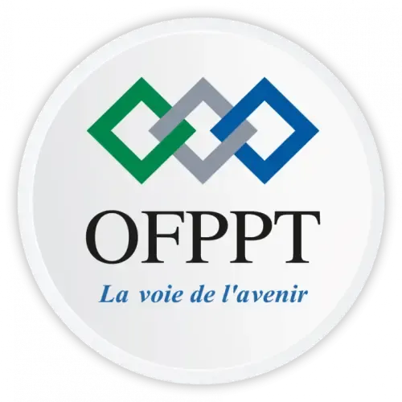
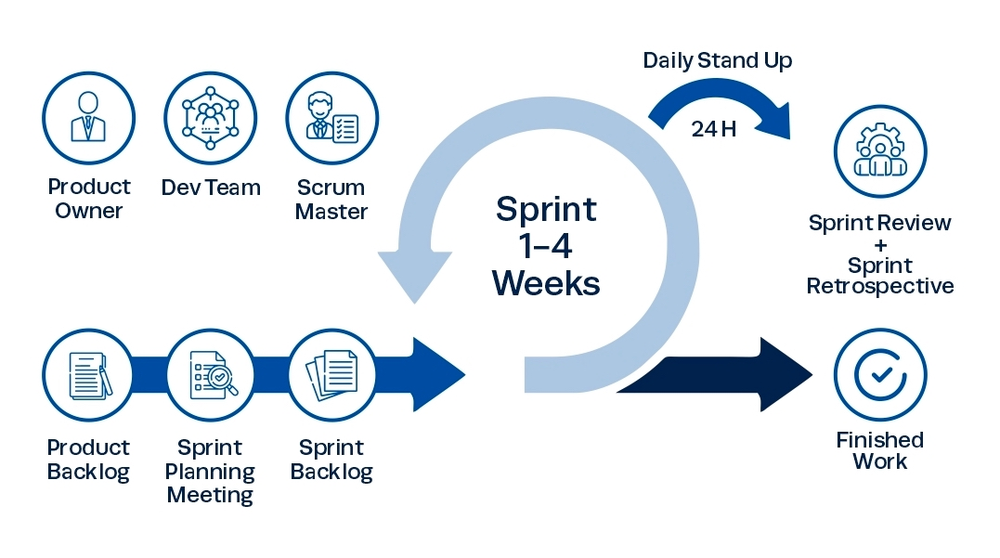
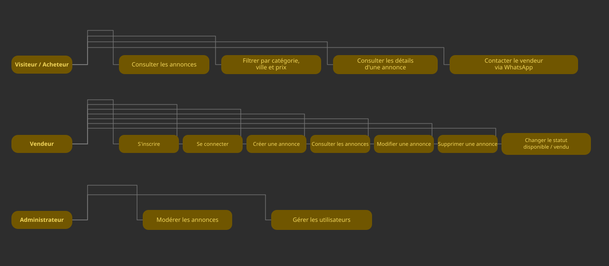
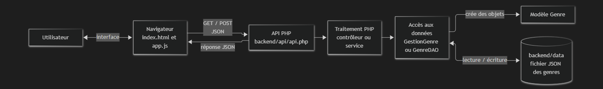
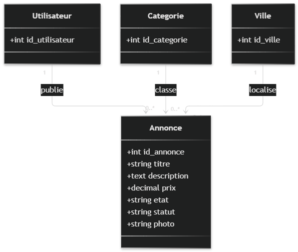

<!-- _class: title-slide -->

  
  

PRÉSENTATION DU PROJET FIL ROUGE

# TECHSWAP MOROCCO

Plateforme de vente et d'achat d'appareils électroniques d'occasion.

  

    RÉALISÉ PAR
    Mounir L Maimouni
  

  

    FILIÈRE
    Développement Web-Mobile
  

  

    ÉTABLISSEMENT
    Solicode Tanger
  

  

    ENCADRANT
    ES-seraj Fouad
  

  

    ANNÉE DE FORMATION
    2026-2027
  

---

## Remerciements

---

## Introduction

---

## Contexte du projet

---
# #methode de travail
---
<!-- _class: image-only -->

## Scrum

---
<!-- _class: image-only -->

## Processus 2TUP

---
<!-- _class: image-only -->

## Design Thinking

---

## planification
---
## Branche fonctionnelle

---

## Carte d'empathie

---

## Définition du problème

---

## Idéation

---
<!-- _class: image-only -->

## Diagramme de cas d'utilisation

---

## Stack technologique

- **Backend** · PHP 8.2 · Laravel 12
- **Autorisations** · Spatie Laravel Permission
- **Mobile** · NativePHP
- **Frontend** · Blade · Tailwind CSS · Alpine · Preline · Vite
- **Base de données** · MySQL
- **Diagrammes** · Mermaid · PlantUML

---
<!-- _class: image-only -->

## Architecture

---
<!-- _class: image-only -->

## Diagramme de classes

---
## Prototype musical

- Genres · Artistes · Morceaux
- Création · Consultation · Modification · Suppression
- Statut · Brouillon ou publié
- Couvertures · Fichiers audio

---

## Relations des données

- **Artiste** → plusieurs morceaux
- **Genre** → plusieurs morceaux
- **Morceau** → un artiste + un genre

---

## Structure technique

- **Frontend** · HTML · CSS / Tailwind · JavaScript
- **Backend** · PHP · Contrôleurs · Services · DAO
- **API** · REST
- **Données** · MySQL / MariaDB · prototype JSON

## Maquettes

---

## realisation

---

## Conclusion

